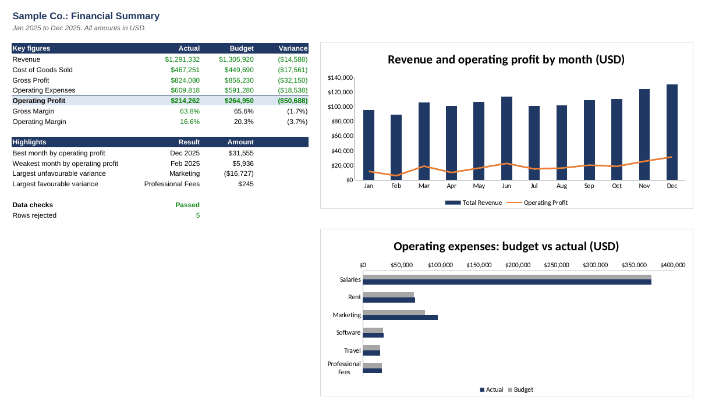

# Financial Report Automation

A Python tool that turns raw transaction exports into a finished Excel financial report: monthly P&L, budget vs actual, charts and data quality checks. One command replaces the manual work of copying, cleaning and formatting spreadsheets.



**[Download the sample report](output/sample_financial_report.xlsx)**. All data in this project is fictional.

## What it does

- **Cleans the data:** checks every transaction and sets aside bad rows (invalid dates, invalid amounts, unknown categories, missing values, possible duplicates) with a reason.
- **Builds the P&L:** revenue, cost of goods sold, gross profit, operating expenses, operating profit and margins for each month.
- **Compares against budget:** shows each category's variance and flags it as favourable or unfavourable.
- **Summarises the results:** key figures, best and weakest months, largest variances and two charts on one page.
- **Proves the numbers tie out:** reconciles row counts and totals from the source file through to the P&L.

## Why the report uses live formulas

The analysis sheets contain Excel formulas rather than pasted values, so a finance reviewer can click any number and trace it back to the underlying transactions.

| Sheet | Contents |
| --- | --- |
| Summary | Key figures, highlights and charts |
| Monthly P&L | Income statement by month |
| Budget vs Actual | Variance by category |
| Data Checks | Reconciliation and rejected rows |
| Transactions | Cleaned source data |
| Budget | Budget data |

## Quick start

Requires Python 3.10 or later.

```bash
pip install -r requirements.txt
python -m finreport --company "Sample Co." --output output/financial_report.xlsx
```

Excel calculates the formulas when the file opens. If it opens in Protected View, select **Enable Editing**.

## Use your own data

Point the command at your own files:

```bash
python -m finreport \
  --transactions path/to/transactions.csv \
  --budget path/to/budget.csv \
  --categories path/to/categories.csv \
  --company "Your Company" \
  --output output/financial_report.xlsx
```

| File | Columns | Notes |
| --- | --- | --- |
| Transactions | `date`, `description`, `category`, `amount` | Dates use `YYYY-MM-DD`. Enter revenue and costs as positive amounts, and refunds as negative amounts. |
| Budget | `month`, `category`, `amount` | Months use `YYYY-MM`. |
| Categories | `category`, `group` | Group is `Revenue`, `Cost of Goods Sold` or `Operating Expenses`. |

Identical rows are treated as possible duplicates, and only the first is kept. Review them on the Data Checks sheet, because two genuine transactions can look the same.

## Tests

```bash
pytest
```

The tests cover the validation rules. They also recalculate the workbook with LibreOffice and compare its formulas with an independent pandas calculation, cell by cell. Those workbook tests are skipped if LibreOffice is not installed.

## Project structure

```text
finreport/   Loading, validation and report building
scripts/     Generator for the fictional sample data
data/        Sample input files
output/      Sample report
tests/       Automated tests
```

## Built with

Python, pandas, openpyxl and pytest.

## License

MIT
